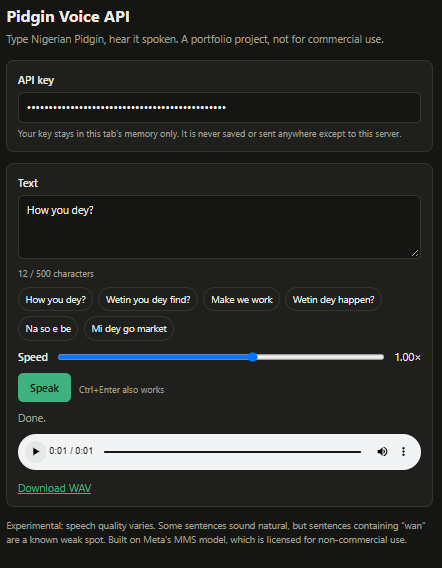

# Pidgin Voice API

A small text-to-speech API for Nigerian Pidgin, with a browser playground. I built it as a portfolio and learning project to practise designing a voice API end to end: input validation, authentication, a consistent error format, and an engine design that lets new models be added without rewriting the service.

**Status:** experimental. The speech quality is inconsistent, and I explain exactly how in the quality note below.



Demo video: _(Demo video: coming soon.)_

## What it does

The API turns Nigerian Pidgin text into spoken audio. I send a JSON request to `POST /v1/speech` with my text, and the server replies with a WAV file. Every request to `/v1/` needs an API key, and every failure returns the same JSON error format with a request ID that I can trace in the logs.

The playground at `/playground` is a single page where I can type text, pick a sample sentence, change the speed, listen to the result, and download the audio. The page never stores the API key. It keeps the key in memory for the open tab only. The playground and the status route at `/` are public, and everything under `/v1/` requires a key.

## A note on quality

I want to be upfront about this. The model I used is a general-purpose multilingual speech model, not one trained specifically for Pidgin, and it shows. In the main round of my informal listening tests, 6 of the 14 sentences sounded acceptable, and the rest had mispronounced words or an unnatural rhythm.

The pattern I noticed is that sentences built on common Pidgin function words, such as "How you dey?", "Wetin you dey find?", and "Make we work", sounded fine. Sentences containing "wan" sounded off in every spelling I tried. One respelling, "wahn", sounded best of the variants, but I did not confirm that it fixes the problem. I am a single listener, and I did not run a formal evaluation, so please treat this as an honest first impression and not as a benchmark.

I started this project with Igbo, because it is the language I know best. The Igbo model I could find was a community fine-tune, and it sounded unnatural to me, with unclear words and poor rhythm, so I switched to Pidgin, where the same kind of model gave noticeably better results. The scripts from that first attempt are kept in `experiments/`.

## Samples

These audio files were generated with the same model that the API uses, and they are the sentences that sounded good to me. GitHub may offer to download a file instead of playing it in the browser.

| File                                                                                 | Text                                                                       |
| ------------------------------------------------------------------------------------ | -------------------------------------------------------------------------- |
| [how-you-dey.wav](samples/how-you-dey.wav)                                           | How you dey?                                                               |
| [wetin-you-dey-find.wav](samples/wetin-you-dey-find.wav)                             | Wetin you dey find?                                                        |
| [make-we-work.wav](samples/make-we-work.wav)                                         | Make we work                                                               |
| [wetin-dey-happen.wav](samples/wetin-dey-happen.wav)                                 | Wetin dey happen?                                                          |
| [na-so-e-be.wav](samples/na-so-e-be.wav)                                             | Na so e be                                                                 |
| [mi-dey-go-market.wav](samples/mi-dey-go-market.wav)                                 | Mi dey go market                                                           |
| [wetin-you-dey-do-for-house-today.wav](samples/wetin-you-dey-do-for-house-today.wav) | Wetin you dey do for house today? (acceptable, but weaker than the others) |

## Run it locally

I developed and tested this on Windows with Git Bash and Python 3.14. On Linux and macOS the only difference I would expect is how the virtual environment is activated (`source .venv/bin/activate`), but I have not tested those systems.

```bash
git clone https://github.com/Ikon-001/voice-api.git
cd voice-api
py -m venv .venv
source .venv/Scripts/activate
pip install -r requirements.txt
cp .env.example .env
```

Next I generate an API key and put it in `.env` after `API_KEYS=`. Several keys can be listed, separated by commas.

```bash
python -c "import secrets; print('vk_' + secrets.token_urlsafe(32))"
```

Then I start the server and open `http://127.0.0.1:5000/playground`.

```bash
flask --app app run
```

The first request downloads the model, which is about 109 MB, and then loads it, so it takes a few seconds. After that, requests are quick. The server reads `.env` only when it starts, so I restart it after changing a key. The Flask development server is fine for trying the project out, but it is not meant for production.

## API reference

### `POST /v1/speech`

Every request needs the header `Authorization: Bearer <your key>` and a JSON body.

| Field      | Description                                                                                                                |
| ---------- | -------------------------------------------------------------------------------------------------------------------------- |
| `text`     | Required. The text to speak, up to 500 characters.                                                                         |
| `language` | Optional. The language code. It defaults to `pcm` for Nigerian Pidgin, which is the only language available at the moment. |
| `speed`    | Optional. A number from 0.7 to 1.2. It defaults to 1.0.                                                                    |
| `format`   | Optional. Only `wav` is supported at the moment.                                                                           |

```bash
curl -X POST http://127.0.0.1:5000/v1/speech \
  -H "Authorization: Bearer YOUR_KEY" \
  -H "Content-Type: application/json" \
  -d '{"text": "How you dey?"}' \
  --output speech.wav
```

On success, the response is the audio itself with the content type `audio/wav`. Every response, successful or not, includes an `X-Request-ID` header.

### Errors

Every error has the same shape, so a client only has to handle one format.

```json
{
  "error": {
    "code": "invalid_api_key",
    "message": "That API key is not valid.",
    "request_id": "2e5c949a3317"
  }
}
```

| Status | Codes                                                                            |
| ------ | -------------------------------------------------------------------------------- |
| 400    | `invalid_request`, `text_too_long`, `unsupported_language`, `unsupported_format` |
| 401    | `missing_api_key`, `invalid_auth_header`, `invalid_api_key`                      |
| 404    | `not_found`                                                                      |
| 405    | `method_not_allowed`                                                             |
| 500    | `engine_error`, `internal_error`, `server_misconfigured`                         |

## How it works

The code lives in the `voice_api` package. Each speech model is an engine class that implements a small interface, and the endpoint finds the right engine by language code. This means a new voice or model can be added by writing one class and registering it, without touching the endpoint.

The current engine runs a Nigerian Pidgin model through the ONNX runtime. I chose this route on purpose, because it needs no PyTorch, so the whole environment comes to about 160 MB with everything installed, compared with over a gigabyte for a PyTorch-based setup. API keys are read from the `.env` file, which is excluded from Git, and they are compared in constant time. If no keys are configured, the server refuses every request instead of running open.

```
app.py                  Flask app: routes, request IDs, error handlers
voice_api/auth.py       API key checking
voice_api/errors.py     The shared error format
voice_api/audio.py      Turns model output into WAV bytes
voice_api/engines/      The engine interface and the Pidgin engine
static/playground.html  The browser playground
samples/                Audio samples that sounded good
experiments/            Scripts I used to test models (the Igbo ones need PyTorch)
```

## Planned

Speech recognition is planned but not built. The interface for it already exists in `voice_api/engines/base.py`, so adding it later means writing one engine class and one endpoint. The candidate I would test first is a small Nigerian Pidgin fine-tune of the Moonshine model, which I have not tried yet. I would also look at the speech models released with Nigeria's N-ATLAS project, after checking their licence and availability.

Other ideas that I have noted but not started are a client that reads a selected part of the screen aloud, captions for video playing on screen, and a voice-note flow built in n8n.

## Limitations and licensing

This project is for learning and for my portfolio, and it must not be used commercially. The Pidgin voice comes from Meta's MMS text-to-speech models (Pratap et al., 2023), which Meta releases under the CC BY-NC 4.0 licence, so commercial use is not allowed. The engine downloads an ONNX conversion of those models, published on Hugging Face as `Axiveri/Renpiper-mms-onnx-V1`. Its model card states that the weights are Meta's, unmodified, that only the file format was converted, and that the same CC BY-NC 4.0 terms apply. I do not include the model files in this repository, and I did not change them. The audio samples in `samples/` were generated with this model, so I treat them as non-commercial too.

I last checked these licence statements on 25 November 2026. Anyone building on this project should check them again: [Meta's model page](https://huggingface.co/facebook/mms-tts), [the converted model](https://huggingface.co/Axiveri/Renpiper-mms-onnx-V1), and the [licence text](https://creativecommons.org/licenses/by-nc/4.0/).

## Acknowledgements

I used the public documentation of Spitch, a company that builds speech AI for African languages, as a reference for what a good voice API looks like. This project is not affiliated with Spitch, and it does not claim to match the quality of their service. Thanks also to Meta for the MMS models and to the `sherpa-onnx` project for the runtime.
The MMS models are described in Vineel Pratap et al., "Scaling Speech Technology to 1,000+ Languages", arXiv:2305.13516 (2023).

## Licence

My own code is released under the MIT licence (see `LICENSE`). That licence covers only the code in this repository. The model is under CC BY-NC 4.0, as described above.
